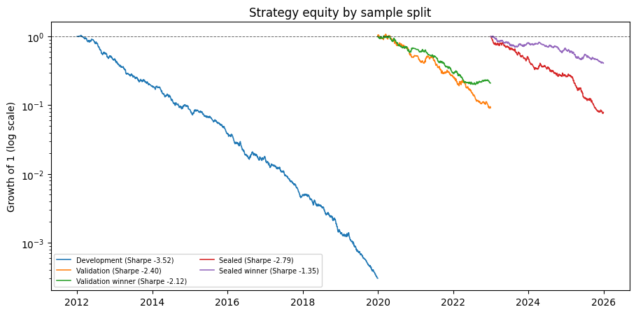
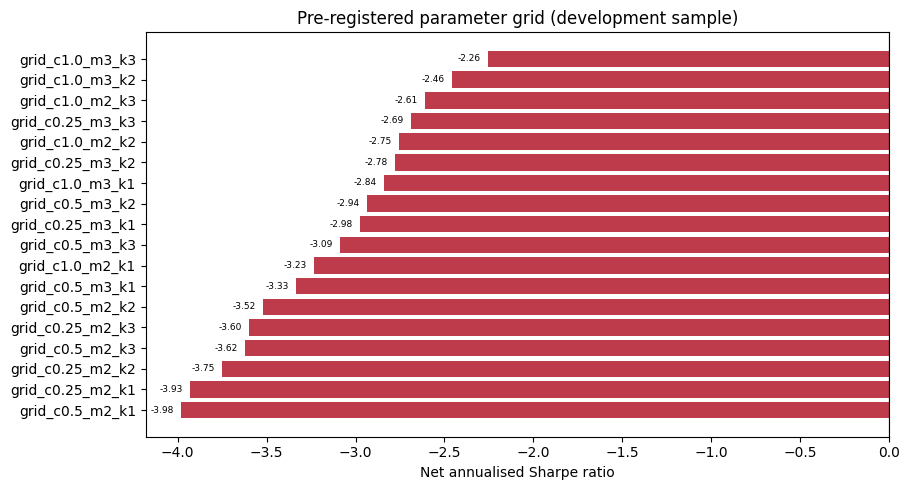
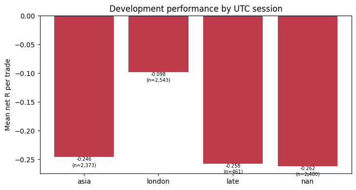
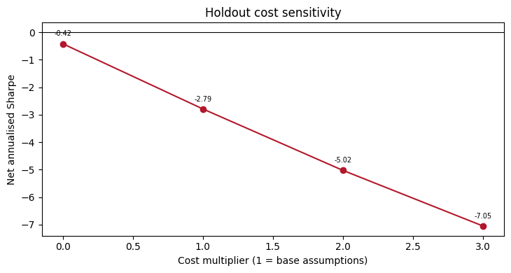
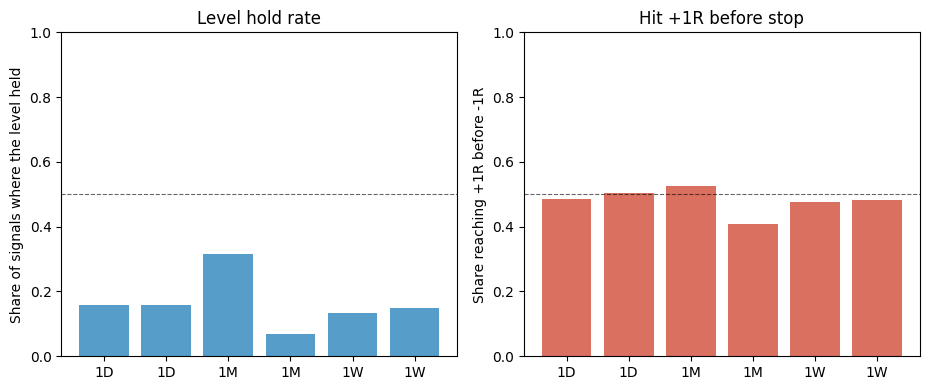
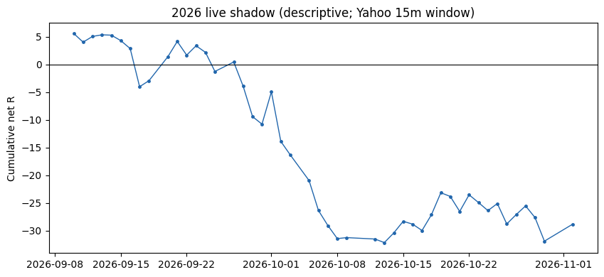

# Multi-Timeframe Key Levels: A Pre-Registered Replication and Null Result

**Working paper / reproducible research repository.**  Generated 2026-11-02 14:40 UTC from `results/`; every number below is read from a machine-produced table.  The strategy is an explicit operationalisation of a discretionary Arabic-language practitioner transcript, not a claim about the individual trader.

## Abstract

We test a widely circulated multi-timeframe key-level strategy on eight liquid instruments over 2012--2025. On the 2012--2019 development sample (7,891 trades), the gross mean return is -0.015R per trade and the net mean return is -0.205R after a conservative half-spread-plus-slippage assumption (net annualised Sharpe -3.52). All 18 pre-registered parameter combinations have a negative net Sharpe ratio. On the sealed 2023--2025 holdout (3,155 trades), the net mean return is -0.166R and the net annualised Sharpe is -2.79; the pre-registered success criterion is not met. In a separate event study of executed signals, the strict hold rate (no close through the level over the next 96 bars) was 15.5%, and price reached +1R before -1R in 49.2% of cases. Even the weaker +1R measure is far below the 90% success rate claimed by practitioners. The evidence rejects the strategy as operationalised here: the gross mean return is slightly negative, the result is stable across a pre-registered parameter grid, and the sealed holdout does not reverse the conclusion.

## 1. Research question

The practitioner literature and trading education industry frequently assert that multi-timeframe support/resistance levels, combined with a higher-timeframe trend filter and a lower-timeframe confirmation candle, produce a high-probability reversal trade. The strongest version of the claim is that the level 'holds' about 90% of the time. This project asks a narrower, testable question: **when the discretionary workflow is translated into deterministic rules, does it produce positive risk-adjusted net performance that survives realistic costs, a sealed holdout, and multiple-testing correction?** The answer is allowed to be no, and the pre-registration commits to reporting it.

The pre-registered contract, including the primary endpoint and every rule, is in [`preregistration/PROTOCOL.md`](preregistration/PROTOCOL.md). Pre-freeze amendments and post-freeze deviations are in [`preregistration/DEVIATIONS.md`](preregistration/DEVIATIONS.md).

## 2. Operational definition of the strategy

Monthly, weekly, and daily pivots are clustered in price with a tolerance of `0.50 x ATR14(D1)` and become tradable after at least two pivots. On 15-minute bars a level is a resistance if the bar trades through it and closes back below it, and a support in the mirror case. The 4-hour trend is defined by the last two confirmed swing highs and lows. A trade requires: trend agreement; a level touch; two consecutive closes on the rejected side; a directional candle; and a chase of no more than `1 x ATR15`. Entry is at the next 15-minute open. The stop is the more conservative of the level plus `0.25 x ATR15` and the five-bar extreme plus `0.10 x ATR15`, capped at `4 x ATR15`. The target is the nearest opposite active level, at least `1R` away, defaulting to `2R` and capped at `5R`. Maximum holding period is 96 bars. If the stop and target share a bar, the stop is assumed first. Risk is 0.5% of equity per trade.

The exact parameter values, including the nine ablations and the 18-point grid, are in [`config/base.yaml`](config/base.yaml) and reproduced in the paper's design table.

## 3. Data

The primary sample is HistData.com Generic ASCII M1 bid bars for EURUSD, GBPUSD, USDJPY, AUDUSD, USDCAD, XAUUSD, SPXUSD, and NSXUSD, 2012-01-01 to 2025-12-31 (112 files, approximately 2.6 GB). Bars are resampled to 15 minutes (entry), 4 hours (trend), and daily/weekly/monthly (levels). No future bar is used before its close. HistData timestamps are treated as fixed UTC-5 without DST, per the vendor specification. The processed sample contains 346,372 EURUSD 15-minute bars, 330,920 XAUUSD bars, and 324,578 SPXUSD bars.

An independent vendor check compares weekly close-to-close returns with Yahoo Finance daily bars. Yahoo data are never mixed into the historical backtest. The 2026 live shadow uses Yahoo 15-minute bars, whose public window is roughly 59 days, and is explicitly descriptive.

**Timestamp caveat.** HistData does not publish whether the M1 timestamp is the bar open or the bar close. Internal evidence (a full day of 00:00--23:59 bars) is consistent with bar-open timestamps. The resampler uses right-closed, right-labelled bins, so higher-timeframe labels are approximately true closes and cross-timeframe ordering is causal. The residual ambiguity is documented as a limitation rather than assumed away.

## 4. Execution and cost model

Trades enter at the next bar's open and exit at the stop, target, trend flip, time limit, or end of data. A gap through the stop fills at the next available open; a gap through the target does not enter the trade. Costs are charged on both sides as half the quoted spread plus an adverse slippage allowance. Base round-trip costs range from 1.0 pip (EURUSD) to 2.0 index points (NSXUSD). The holdout reports 0x, 1x, 2x, and 3x cost sensitivity.

## 5. Statistical protocol

The sample is split into development (2012--2019), validation (2020--2022), and a sealed holdout (2023--2025). The base specification is fixed by faithfulness to the transcript, not optimised. The 18-point grid is selected on development only; the winner is evaluated unchanged on validation and holdout. Inference uses the stationary bootstrap (Politis--Romano), the deflated Sharpe ratio (Bailey--Lopez de Prado), the probability of backtest overfitting via CSCV (Bailey--Borwein--Lopez de Prado--Zhu), the White Reality Check, Hansen's SPA test, and Benjamini--Hochberg control of the per-instrument false discovery rate. The holdout is opened once, after a SHA-256 code freeze.

## 6. Results

### 6.1 Development sample

The base strategy produced 7,891 trades over 2,087 trading days. Gross mean return was -0.015R per trade and net mean return was -0.205R. The annualised net Sharpe was -3.52, maximum drawdown -99.97%, win rate 29.07%, and profit factor 0.747. The cost drag was +0.190R per trade. The mean net R is statistically distinguishable from zero (t = -10.79, p = 5.66e-27), but in the negative direction.



### 6.2 Parameter grid and ablations

The 18-point grid spans cluster tolerance, minimum touches, and confirmation closes. Every combination has a negative net Sharpe. The least-negative combination is `grid_c1.0_m3_k3` (Sharpe -2.26, mean net R -0.215), selected only by ranking losses. This is a sensitivity surface, not evidence of a profitable region.

| Variant | Cluster ATR | Min touches | Confirms | Trades | Sharpe | Mean net R | Win rate |
|:---|---:|---:|---:|---:|---:|---:|---:|
| grid_c1.0_m3_k3 | 1.00 | 3 | 3 | 3,675 | -2.26 | -0.215 | 25.66% |
| grid_c1.0_m3_k2 | 1.00 | 3 | 2 | 4,760 | -2.46 | -0.195 | 27.63% |
| grid_c1.0_m2_k3 | 1.00 | 2 | 3 | 4,494 | -2.61 | -0.218 | 26.10% |
| grid_c0.25_m3_k3 | 0.25 | 3 | 3 | 5,208 | -2.69 | -0.201 | 28.32% |
| grid_c1.0_m2_k2 | 1.00 | 2 | 2 | 5,831 | -2.75 | -0.191 | 28.18% |
| grid_c0.25_m3_k2 | 0.25 | 3 | 2 | 6,774 | -2.78 | -0.173 | 29.88% |
| grid_c1.0_m3_k1 | 1.00 | 3 | 1 | 7,191 | -2.84 | -0.174 | 29.15% |
| grid_c0.5_m3_k2 | 0.50 | 3 | 2 | 6,002 | -2.94 | -0.201 | 28.41% |
| grid_c0.25_m3_k1 | 0.25 | 3 | 1 | 10,071 | -2.98 | -0.156 | 31.30% |
| grid_c0.5_m3_k3 | 0.50 | 3 | 3 | 4,609 | -3.09 | -0.239 | 26.60% |
| grid_c1.0_m2_k1 | 1.00 | 2 | 1 | 8,702 | -3.23 | -0.177 | 29.56% |
| grid_c0.5_m3_k1 | 0.50 | 3 | 1 | 8,922 | -3.33 | -0.189 | 29.44% |
| grid_c0.5_m2_k2 | 0.50 | 2 | 2 | 7,891 | -3.52 | -0.205 | 29.07% |
| grid_c0.25_m2_k3 | 0.25 | 2 | 3 | 7,547 | -3.60 | -0.219 | 29.07% |
| grid_c0.5_m2_k3 | 0.50 | 2 | 3 | 6,073 | -3.62 | -0.242 | 27.27% |
| grid_c0.25_m2_k2 | 0.25 | 2 | 2 | 9,712 | -3.75 | -0.193 | 30.55% |
| grid_c0.25_m2_k1 | 0.25 | 2 | 1 | 14,328 | -3.93 | -0.169 | 32.01% |
| grid_c0.5_m2_k1 | 0.50 | 2 | 1 | 11,709 | -3.98 | -0.191 | 30.23% |



All four trading sessions have a negative mean net R; the late session is the worst.



Removing the trend filter, the confirmation closes, or the directional candle increases the trade count and makes performance worse. No ablation recovers a positive gross edge. The complete ablation ledger is in Appendix A.

### 6.3 Validation sample

On 2020--2022 the base strategy produced 3,556 trades with net mean R -0.121 and net Sharpe -2.40. The development grid winner produced 1,831 trades with net mean R -0.169. The sign of the development result did not reverse.

### 6.4 Sealed holdout

The holdout produced 3,155 trades. Net mean R was -0.166, net Sharpe -2.79, maximum drawdown -92.45%, and win rate 29.38%. The pre-registered primary endpoint required a positive net mean R and a positive net Sharpe; it is not met.

### 6.5 Cost sensitivity

| Cost multiplier | Trades | Mean net R | Net Sharpe | Max drawdown |
|:---|---:|---:|---:|---:|
| 0.00x | 3,155 | -0.028 | -0.42 | -48.72% |
| 1.00x | 3,155 | -0.166 | -2.79 | -92.45% |
| 2.00x | 3,155 | -0.304 | -5.02 | -99.04% |
| 3.00x | 3,155 | -0.442 | -7.05 | -99.88% |



### 6.6 Multiple-testing inference

| Test | Value | Detail |
|:---|---:|---:|
| DSR (base) | 1.14e-23 | -0.18 vs threshold 0.20 |
| DSR (grid winner) | 4.17e-15 | -0.08 vs threshold 0.20 |
| PBO (CSCV) | 0.1071 | 924 splits, 18 variants |
| Reality Check p-value | 1.0000 | stat -0.04 |
| SPA p-value | 1.0000 | stat 0.00 |
| Alpha vs equal-weight (base) | -54.46% | t = -5.09, p = 3.65e-07; beta 0.06 |
| Alpha vs equal-weight (winner) | -23.93% | t = -2.52, p = 0.0119; beta 0.04 |
| Bootstrap 95% CI, mean net R | [-0.228, -0.101] | point -0.166; 5,000 resamples |
| Bootstrap 95% CI, net Sharpe | [-3.96, -1.66] | point -2.79; annualised |
| Trials in DSR | 28 | grid + ablations |
| Random-entry placebo p-value | 0.7180 | observed -0.166 vs placebo -0.149 |
| Random-level placebo p-value | <0.0050 (0/200) | observed -0.166 vs placebo -0.239 |


The stationary-bootstrap 95% confidence interval is [-0.228, -0.101] for mean net R and [-3.96, -1.66] for the annualised net Sharpe, using 5,000 resamples with a mean block of 20 trades. Both intervals lie entirely below zero.

The deflated Sharpe ratio and PBO are the relevant corrections because the grid and the ablations are a deliberate search. A DSR near zero means the selected variant is not distinguishable from the best of a set of noise strategies. The PBO is modest here only because the ranking of a uniformly unprofitable set is stable; it is not evidence of a profitable variant.

The random-entry placebo is not rejected (p = 0.7180): random entries with the same geometry perform at least as well as the strategy's entries. The random-level placebo is rejected in the opposite direction (p < 0.0050 (0/200 draws)): the actual levels are less bad than random active levels. Because the placebo re-derives the stop from the sampled level while holding the target distance fixed, it changes the risk geometry as well as the level location; it is a joint test of level and stop placement, not a pure level-location test. The level filter therefore carries some relative information, but that information does not translate into a positive absolute net return. This is relative, not absolute, skill.

### 6.7 Level-reaction audit and the '90% success' claim

The full strategy is not the only way to test the practitioner claim. We therefore measure, for every executed development signal, whether the marked level held (no close breach by 0.25 ATR against the trade) and whether price reached +1R, +2R, or +3R before the -1R stop.

| Level | Side | N | Hold rate | Hit +1R | Hit +2R | Hit +3R | Mean MFE (R) |
|:---|---:|---:|---:|---:|---:|---:|---:|
| 1D | -1 | 3,262 | 15.79% | 48.65% | 31.55% | 22.32% | +4.481 |
| 1D | 1 | 3,160 | 15.76% | 50.47% | 31.74% | 21.93% | +4.223 |
| 1M | -1 | 38 | 31.58% | 52.63% | 36.84% | 28.95% | +4.045 |
| 1M | 1 | 44 | 6.82% | 40.91% | 18.18% | 11.36% | +3.522 |
| 1W | -1 | 696 | 13.22% | 47.70% | 31.03% | 20.98% | +4.293 |
| 1W | 1 | 691 | 14.91% | 48.34% | 29.09% | 20.41% | +3.931 |
| ALL | 0 | 7,891 | 15.50% | 49.25% | 31.31% | 21.85% | +4.306 |

Pooled, the hold rate is 15.5% and the +1R-before-stop rate is 49.2%. A 90% success claim would require the latter to be near 90%; it is not. The result is descriptive and conditions on the strategy's own entry filter, so it is not a test of every possible level definition, but it is the relevant test of the claim as operationalised.



### 6.8 Data integrity and vendor cross-validation

| Symbol | Weeks | Return corr. | Mean abs weekly diff | HistData vol | Yahoo vol |
|:---|---:|---:|---:|---:|---:|
| EURUSD | 730 | 0.79 | 0.53% | 7.80% | 7.55% |
| GBPUSD | 730 | 0.77 | 0.58% | 8.68% | 8.82% |
| USDJPY | 730 | 0.76 | 0.64% | 9.15% | 9.11% |
| AUDUSD | 730 | 0.78 | 0.67% | 10.05% | 9.77% |
| USDCAD | 730 | 0.76 | 0.50% | 6.82% | 7.03% |
| XAUUSD | 730 | 0.98 | 0.31% | 14.72% | 15.31% |
| SPXUSD | 729 | 1.00 | 0.14% | 15.77% | 15.78% |
| NSXUSD | 729 | 1.00 | 0.14% | 18.71% | 18.76% |

The cross-vendor correlation is high, which rules out a vendor-specific price path as the source of the null. Levels are not compared directly because the vendors quote different instruments (spot versus futures).

Across 40 processed series and 2,930,707 bars, there were 0 duplicate timestamps, 0 OHLC violations, and 0 non-positive prices. The largest absolute 15-minute log return was 7.6%, consistent with a real intraday move rather than a corrupted bar.

Intrabar ambiguity was measured directly: 8 of 7,891 trades (0.1%) had the stop and target inside the same 15-minute bar at some point before exit, and 0 were ambiguous on the entry bar. The stop-first convention therefore cannot explain the result.

### 6.9 Live shadow (2026)

The 2026 shadow produced 207 trades with mean net R -0.139 and win rate 30.92%. The window is roughly 59 days of Yahoo 15-minute data; this is an operational check, not a significance test.



### 6.10 Benchmarks and per-instrument tests

The strategy is also compared with simple alternatives on the same holdout window and cost model. Buy-and-hold and the 50/200-day SMA crossover are positive; the 4-hour trend-only and Donchian benchmarks are negative. The key-level strategy is the worst of the set.

| Benchmark | Days | Annual return | Annual vol | Net Sharpe | Max DD |
|:---|---:|---:|---:|---:|---:|
| buy_and_hold | 783 | 11.74% | 5.88% | 1.92 | -5.75% |
| sma_50_200 | 783 | 3.08% | 6.31% | 0.51 | -5.22% |
| trend_only | 783 | -2.69% | 4.13% | -0.64 | -8.76% |
| donchian_20 | 783 | -2.78% | 3.92% | -0.70 | -8.87% |

Per-instrument one-sided tests of net mean R are Benjamini--Hochberg adjusted. No instrument survives the pre-registered false-discovery-rate control; the smallest raw p-value (NSXUSD) is not significant after adjustment.

| Symbol | One-sided p | BH q | Reject at alpha |
|:---|---:|---:|---:|
| AUDUSD | 1.0000 | 1.0000 | no |
| EURUSD | 0.9069 | 1.0000 | no |
| GBPUSD | 0.9979 | 1.0000 | no |
| NSXUSD | 0.0333 | 0.2665 | no |
| SPXUSD | 0.9549 | 1.0000 | no |
| USDCAD | 0.9998 | 1.0000 | no |
| USDJPY | 0.9909 | 1.0000 | no |
| XAUUSD | 0.7374 | 1.0000 | no |

## 7. Interpretation

The central finding is that the gross edge is approximately zero before any transaction cost. This matters more than the sign of the net result: a strategy with a genuine 90% level-hold rate would earn a positive gross mean R even under pessimistic path assumptions. Costs then turn a zero-mean strategy into a reliably negative one, which is exactly what the net ledger shows.

A negative result of this kind is informative for three reasons. First, it is a direct test of a widely repeated practitioner claim with a pre-registered protocol rather than a post-hoc story. Second, the level-reaction audit separates the claim's mechanism (the level holds) from its profitability implication (the hold can be monetised after costs); the first is weak and the second fails. Third, the result survives a sealed holdout and multiple-testing correction, so it is not an artefact of the development sample.

## 8. Limitations

1. **Operationalisation.** The transcript is discretionary. The rules above are a faithful but explicit translation; a different translation could produce a different result.
2. **Timestamps.** HistData's M1 timestamp convention is undocumented. The resampling is causal and internally consistent, but bar-open versus bar-close ambiguity remains.
3. **Costs.** Spreads and slippage are stylised, not broker quotes. The 0x--3x sensitivity bounds the conclusion but does not model queue position or partial fills.
4. **Intrabar path.** The 15-minute bars cannot order the high and low. Stop-first is a lower bound; the measured ambiguity rate is small, so the bound is tight in this sample.
5. **Universe.** Eight instruments, chosen ex ante. Results may differ in less liquid markets.
6. **Live shadow.** The Yahoo 15-minute window is short. It is descriptive and is not used for confirmatory inference.
7. **News and macro events.** No historical news calendar is used. The base specification is a no-news-filter result; this is a limitation, not a claim that news is irrelevant.

## 9. Reproducibility

```bash
make setup        # install Python dependencies
make download     # HistData M1 files with SHA-256 manifest
make build        # resample to 15m/4h/1D/1W/1M
make development  # base + ablations + 18-point grid
make validation   # 2020-2022 check
make freeze       # SHA-256 code/config freeze
make holdout      # open the sealed 2023-2025 sample once
make audit        # integrity, Yahoo cross-check, level reactions
make live         # 2026 descriptive shadow
make report       # regenerate RESEARCH.md, README.md, preview.html, figures
make pdf          # compile paper/main.tex with TeX Live (Docker)
make test         # unit tests
```

The Docker path is `docker compose run --rm research <command>`. Raw data are not redistributed; the download scripts and SHA-256 manifests are in `data/raw/download_manifest.json`.

The holdout guard is active. `make holdout` refuses to run because the working tree no longer matches `CODE_FREEZE.json` after the presentation and inference-completion edits recorded in `preregistration/DEVIATIONS.md` sections F and G. The opened holdout outputs are retained under `results/holdout/`; re-opening the holdout would violate the pre-registration.

## 10. References

- Arnott, R., Harvey, C. R., & Markowitz, H. (2019). A backtesting protocol in the era of machine learning. *Journal of Financial Data Science*, 1(1), 64--74.
- Bailey, D. H., Borwein, J. M., Lopez de Prado, M., & Zhu, Q. J. (2017). The probability of backtest overfitting. *Journal of Computational Finance*, 20(4), 39--69.
- Bailey, D. H., & Lopez de Prado, M. (2014). The deflated Sharpe ratio: correcting for selection bias, backtest overfitting, and non-normality. *Journal of Portfolio Management*, 40(5), 94--107.
- Benjamini, Y., & Hochberg, Y. (1995). Controlling the false discovery rate: a practical and powerful approach to multiple testing. *Journal of the Royal Statistical Society B*, 57(1), 289--300.
- Brock, W., Lakonishok, J., & LeBaron, B. (1992). Simple technical trading rules and the stochastic properties of stock returns. *Journal of Finance*, 47(5), 1731--1764.
- Claeys, M. (2026). When backtests guess: how trading platforms silently fabricate results. SSRN Working Paper 6240638. https://papers.ssrn.com/sol3/papers.cfm?abstract_id=6240638
- Deprez, N., & Frommel, M. (2024). Are simple technical trading rules profitable in bitcoin markets? *International Review of Economics & Finance*, 93, 858--874.
- Hansen, P. R. (2005). A test for superior predictive ability. *Journal of Business & Economic Statistics*, 23(4), 365--380.
- Harvey, C. R., & Liu, Y. (2020). False (and missed) discoveries in financial economics. *Journal of Finance*, 75(5), 2503--2553.
- Lo, A. W., Mamaysky, H., & Wang, J. (2000). Foundations of technical analysis: computational algorithms, statistical inference, and empirical implementation. *Journal of Finance*, 55(4), 1705--1765.
- Menkhoff, L., & Taylor, M. P. (2007). The obstinate passion of foreign exchange professionals: technical analysis. *Journal of Economic Literature*, 45(4), 936--972.
- Osler, C. L. (2003). Currency orders and exchange rate dynamics: an explanation for the predictive success of technical analysis. *Journal of Finance*, 58(5), 1791--1820.
- Politis, D. N., & Romano, J. P. (1994). The stationary bootstrap. *Journal of the American Statistical Association*, 89(428), 1303--1313.
- Rink, K. (2023). The predictive ability of technical trading rules: an empirical analysis of developed and emerging equity markets. *Financial Markets and Portfolio Management*. https://doi.org/10.1007/s11408-023-00433-2
- Sullivan, R., Timmermann, A., & White, H. (1999). Data-snooping, technical trading rule performance, and the bootstrap. *Journal of Finance*, 54(5), 1647--1691.
- White, H. (2000). A reality check for data snooping. *Econometrica*, 68(5), 1097--1126.

## Appendix A. Full trial ledger

| Kind | Variant | Trades | Sharpe | Mean net R | Win rate | Max DD |
|:---|---:|---:|---:|---:|---:|---:|
| base | base | 7,891 | -3.52 | -0.205 | 29.07% | -99.97% |
| ablation | no_trend | 32,645 | -11.01 | -0.215 | 31.24% | -100.00% |
| ablation | no_confirmation | 14,088 | -4.52 | -0.214 | 29.15% | -100.00% |
| ablation | no_directional | 12,217 | -4.69 | -0.247 | 27.51% | -100.00% |
| ablation | ema_trend | 11,566 | -3.50 | -0.191 | 27.36% | -100.00% |
| ablation | wick_levels | 7,719 | -2.79 | -0.179 | 29.28% | -99.90% |
| ablation | min_touches_3 | 6,002 | -2.94 | -0.201 | 28.41% | -99.77% |
| ablation | cluster_025 | 9,712 | -3.75 | -0.193 | 30.55% | -99.99% |
| ablation | cluster_100 | 5,831 | -2.75 | -0.191 | 28.18% | -99.63% |
| ablation | confirmation_1 | 11,709 | -3.98 | -0.191 | 30.23% | -100.00% |
| ablation | confirmation_3 | 6,073 | -3.62 | -0.242 | 27.27% | -99.95% |
| grid | grid_c0.25_m2_k1 | 14,328 | -3.93 | -0.169 | 32.01% | -100.00% |
| grid | grid_c0.25_m2_k2 | 9,712 | -3.75 | -0.193 | 30.55% | -99.99% |
| grid | grid_c0.25_m2_k3 | 7,547 | -3.60 | -0.219 | 29.07% | -99.97% |
| grid | grid_c0.25_m3_k1 | 10,071 | -2.98 | -0.156 | 31.30% | -99.96% |
| grid | grid_c0.25_m3_k2 | 6,774 | -2.78 | -0.173 | 29.88% | -99.75% |
| grid | grid_c0.25_m3_k3 | 5,208 | -2.69 | -0.201 | 28.32% | -99.51% |
| grid | grid_c0.5_m2_k1 | 11,709 | -3.98 | -0.191 | 30.23% | -100.00% |
| grid | grid_c0.5_m2_k2 | 7,891 | -3.52 | -0.205 | 29.07% | -99.97% |
| grid | grid_c0.5_m2_k3 | 6,073 | -3.62 | -0.242 | 27.27% | -99.95% |
| grid | grid_c0.5_m3_k1 | 8,922 | -3.33 | -0.189 | 29.44% | -99.98% |
| grid | grid_c0.5_m3_k2 | 6,002 | -2.94 | -0.201 | 28.41% | -99.77% |
| grid | grid_c0.5_m3_k3 | 4,609 | -3.09 | -0.239 | 26.60% | -99.68% |
| grid | grid_c1.0_m2_k1 | 8,702 | -3.23 | -0.177 | 29.56% | -99.97% |
| grid | grid_c1.0_m2_k2 | 5,831 | -2.75 | -0.191 | 28.18% | -99.63% |
| grid | grid_c1.0_m2_k3 | 4,494 | -2.61 | -0.218 | 26.10% | -99.29% |
| grid | grid_c1.0_m3_k1 | 7,191 | -2.84 | -0.174 | 29.15% | -99.84% |
| grid | grid_c1.0_m3_k2 | 4,760 | -2.46 | -0.195 | 27.63% | -98.95% |
| grid | grid_c1.0_m3_k3 | 3,675 | -2.26 | -0.215 | 25.66% | -98.00% |
| grid | grid_c0.25_m2_k1 | 14,328 | -3.93 | -0.169 | 32.01% | -100.00% |
| grid | grid_c0.25_m2_k2 | 9,712 | -3.75 | -0.193 | 30.55% | -99.99% |
| grid | grid_c0.25_m2_k3 | 7,547 | -3.60 | -0.219 | 29.07% | -99.97% |
| grid | grid_c0.25_m3_k1 | 10,071 | -2.98 | -0.156 | 31.30% | -99.96% |
| grid | grid_c0.25_m3_k2 | 6,774 | -2.78 | -0.173 | 29.88% | -99.75% |
| grid | grid_c0.25_m3_k3 | 5,208 | -2.69 | -0.201 | 28.32% | -99.51% |
| grid | grid_c0.5_m2_k1 | 11,709 | -3.98 | -0.191 | 30.23% | -100.00% |
| grid | grid_c0.5_m2_k2 | 7,891 | -3.52 | -0.205 | 29.07% | -99.97% |
| grid | grid_c0.5_m2_k3 | 6,073 | -3.62 | -0.242 | 27.27% | -99.95% |
| grid | grid_c0.5_m3_k1 | 8,922 | -3.33 | -0.189 | 29.44% | -99.98% |
| grid | grid_c0.5_m3_k2 | 6,002 | -2.94 | -0.201 | 28.41% | -99.77% |
| grid | grid_c0.5_m3_k3 | 4,609 | -3.09 | -0.239 | 26.60% | -99.68% |
| grid | grid_c1.0_m2_k1 | 8,702 | -3.23 | -0.177 | 29.56% | -99.97% |
| grid | grid_c1.0_m2_k2 | 5,831 | -2.75 | -0.191 | 28.18% | -99.63% |
| grid | grid_c1.0_m2_k3 | 4,494 | -2.61 | -0.218 | 26.10% | -99.29% |
| grid | grid_c1.0_m3_k1 | 7,191 | -2.84 | -0.174 | 29.15% | -99.84% |
| grid | grid_c1.0_m3_k2 | 4,760 | -2.46 | -0.195 | 27.63% | -98.95% |
| grid | grid_c1.0_m3_k3 | 3,675 | -2.26 | -0.215 | 25.66% | -98.00% |

## Appendix B. Files

- `preregistration/PROTOCOL.md` -- the research contract.
- `preregistration/DEVIATIONS.md` -- pre-freeze amendments and post-freeze changes.
- `config/base.yaml`, `config/instruments.yaml` -- frozen parameters and costs.
- `src/klab/` -- download, timeframes, levels, trend, strategy, backtest, statistics, audit, live, report.
- `results/development/`, `results/validation/`, `results/holdout/`, `results/audit/`, `results/live/` -- machine outputs.
- `paper/main.tex`, `paper/references.bib` -- the manuscript.

