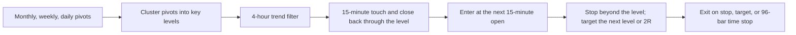

<div align="center">


# KeyLevel Lab

**An independent, pre-registered test of the multi-timeframe “key level” strategy that circulates in trading rooms — on 2.93 million bars, 14,602 trades, and a sealed 2023–2025 holdout.**

[](#-the-30-second-ceo-summary)
[](#-the-evidence-in-one-screen)
[](#-data-quality-and-integrity)

[](paper/main.pdf)
[](#-quick-start)
[](#-licence-and-commercial-use)

[**30-second summary**](#-the-30-second-ceo-summary) · [**Evidence**](#-the-evidence-in-one-screen) · [**Beginner guide**](#-beginner-guide--read-this-and-you-are-a-professional) · [**Interactive report**](#-interactive-report) · [**Quick start**](#-quick-start) · [**Publish this site**](#-publish-the-interactive-report-github-pages)

</div>

---

> [!IMPORTANT]
> **The strategy does not work as specified.** On 3,155 trades it was never allowed to see during development, it lost **{{HOLD_NET_R}}R per trade after costs** and produced a **net Sharpe ratio of {{HOLD_SHARPE}}**. The pre-registered success test failed. This repository is the evidence pack: it shows exactly what was tested, why the claim fails, and how to reuse the method to avoid the same mistake.
>
> **It is not a trading signal, not financial advice, and not a promise of future returns.** It is a research asset for people who allocate capital, teach finance, build strategies, or buy due diligence.

---

## 💼 The 30-second CEO summary

**The claim.** A popular multi-timeframe method says that when monthly, weekly, and daily price pivots cluster into a “key level,” price will react there. With a 4-hour trend filter and a 15-minute confirmation, the method is said to produce unusually high win rates.

**What we did.** We wrote the rules down *before* looking at the answer, froze the code, and tested the method on eight liquid instruments from 2012 to 2025. We then opened a sealed 2023–2025 holdout **once**. We charged realistic spreads and slippage on both sides of every trade. We compared the result with simple benchmarks, random entries, random levels, and a parameter grid. We corrected for the fact that searching many variants makes any backtest look better.

**What we found.** The method is not profitable. The development sample lost **{{DEV_NET_R}}R per trade** after costs. All **{{GRID_VARIANTS}}** pre-registered parameter combinations lost money. The sealed holdout lost **{{HOLD_NET_R}}R per trade**, with a **{{HOLD_SHARPE}}** net Sharpe ratio and a **{{HOLD_DD_ABS}}** maximum drawdown. The strict “level holds” rate was **{{HOLD_RATE}}**. Price reached +1R before −1R only **{{HIT1}}** of the time — close to a coin flip and nowhere near the 90% success rate often claimed.

**What it means for a business.** Do not allocate capital to this rule as written. The value of the repository is the opposite: it is a **repeatable, auditable filter** that can stop a bad strategy before it reaches a portfolio. The same engine can test the next idea, the next vendor, or the next trading guru — with pre-registration, a sealed holdout, realistic costs, and overfitting controls already wired in.

**The one-sentence version.** *A widely repeated key-level strategy was tested honestly and failed; the method used to prove that is the product.*

---

## 🎯 The claim vs the evidence

| What practitioners often claim | What the data shows | Where to look |
|:---|:---|:---|
| “Key levels are high-probability reversal points.” | The level survived without a close through it only **{{HOLD_RATE}}** of the time. | [Level audit](#-the-evidence-in-one-screen) |
| “Multi-timeframe confluence gives a 90% win rate.” | The holdout win rate was **{{HOLD_WIN}}**; profit factor was **{{HOLD_PF}}**. | [Headline results](#-the-evidence-in-one-screen) |
| “The strategy works; you just need the right settings.” | **{{GRID_VARIANTS}} of {{GRID_VARIANTS}}** pre-registered variants had a negative net Sharpe. | [Parameter grid](#-the-evidence-in-one-screen) |
| “Costs are a detail.” | At zero cost the holdout still lost **−0.028R** per trade; at the modelled cost it lost **{{HOLD_NET_R}}R**. | [Cost sensitivity](#-the-evidence-in-one-screen) |
| “The backtest proves it.” | The deflated Sharpe ratio is essentially zero after **{{N_TRIALS}}** trials; the Reality Check and SPA p-values are **{{RC_P}}**. | [Inference](#-the-evidence-in-one-screen) |
| “It beats the market.” | The holdout net Sharpe was **{{HOLD_SHARPE}}**; buy-and-hold was **+1.92** on the same window. | [Benchmarks](#-the-evidence-in-one-screen) |

---

## 🧭 Table of contents

- [The 30-second CEO summary](#-the-30-second-ceo-summary)
- [The claim vs the evidence](#-the-claim-vs-the-evidence)
- [What this repository is (and is not)](#-what-this-repository-is-and-is-not)
- [Beginner guide — read this and you are a professional](#-beginner-guide--read-this-and-you-are-a-professional)
- [The evidence in one screen](#-the-evidence-in-one-screen)
- [What was tested](#-what-was-tested)
- [Why the strategy fails](#-why-the-strategy-fails)
- [Why you can trust the numbers](#-why-you-can-trust-the-numbers)
- [Who should use this repository](#-who-should-use-this-repository)
- [What you get](#-what-you-get)
- [Interactive report](#-interactive-report)
- [Quick start](#-quick-start)
- [Repository tour](#-repository-tour)
- [Publish the interactive report (GitHub Pages)](#-publish-the-interactive-report-github-pages)
- [FAQ](#-faq)
- [Glossary](#-glossary)
- [Licence and commercial use](#-licence-and-commercial-use)
- [Citation](#-citation)

**Choose your path:**

| You are… | Read this | Time |
|:---|:---|:---|
| A CEO, allocator, or investment committee member | The 30-second summary, the claim-vs-evidence table, and the business-use section | 5 minutes |
| An analyst doing due diligence | The evidence section, the inference table, the audit, and the limitations | 20 minutes |
| A developer or quant | Quick start, repository tour, tests, and the pre-registration documents | 30 minutes |
| A student or interviewer | The beginner guide, the glossary, and the 12-question interactive quiz | 45 minutes |
| A buyer | What you get, what was tested, why you can trust it, and licensing | 10 minutes |

---

## 🧱 What this repository is (and is not)

| This repository is | This repository is not |
|:---|:---|
| A pre-registered, reproducible replication of a widely repeated strategy | A signal service or a trade recommendation |
| A complete evidence pack with development, validation, and sealed holdout results | A claim that “key levels” can never work in any form |
| A reusable research engine for testing any rule-based strategy | A promise of future returns |
| A teaching tool for costs, overfitting, placebos, and holdouts | A black box that hides its assumptions |
| A business asset for due diligence, education, and licensing | Financial advice |

The strategy tested here is one explicit, mechanical interpretation of a discretionary idea. It is not a claim about the skill or intent of any individual trader. A different rule set may behave differently — and this repository gives you the tools to test it.

---

## 🌱 Beginner guide — read this and you are a professional

> **You do not need a finance degree to understand this page.** Every term is explained in plain language, and the glossary at the end repeats the definitions. Read the ten steps below in order. When you finish, you will understand more about backtesting than most people who use the word “strategy” every day. **You will know more than most interview candidates.**

### Step 1 — What is the question?

A trading “strategy” is a set of rules for when to buy, when to sell, and how much to risk. This repository tests one popular set of rules:

> *“When price reaches a key level built from monthly, weekly, and daily pivots, and the 4-hour trend agrees, enter on a 15-minute confirmation. Put the stop just beyond the level. Aim for the next level or 2R. Hold for at most 96 fifteen-minute bars.”*

The question is not “do I like the idea?” The question is: **if a robot followed these rules exactly, made thousands of trades, and paid real costs, would it make money?**

### Step 2 — What is R?

**R is the amount you risk on one trade.** If you risk $100 and make $200, you made **+2R**. If you lose your $100, you lost **−1R**. Using R makes trades of different sizes comparable.

Why it matters: a strategy can win 90% of the time and still lose money if the losses are large. R captures both the win rate and the size of wins and losses.

### Step 3 — What is a key level?

A **pivot** is a local high or low. A **key level** is a price where several pivots from different timeframes cluster together. The idea is that many traders watch the same price, so reactions should be stronger there.

Think of it like a busy intersection: more people cross there, so more traffic events happen. But “more events” does not tell you which way the cars will turn.

### Step 4 — What are the three timeframes?

- **Monthly / weekly / daily pivots** decide *where* the level is.
- **4-hour swings** decide *which direction* to trade.
- **15-minute bars** decide *when* to enter and where to put the stop.

The claim is that agreement across timeframes filters out noise. The test asks whether that filter survives costs.

### Step 5 — What is a holdout?

A **holdout** is data the strategy was never allowed to see during development. It is the difference between a job interview and a real job.

If you tune a strategy on 2012–2019, then test it on 2020–2022, and then *again* on 2023–2025 without changing anything, the last test is the honest one. In this repository the 2023–2025 holdout was sealed, opened **once**, and never re-opened.

### Step 6 — What is a cost?

Every trade pays a **spread** (the gap between the buy and sell price) and **slippage** (the difference between the price you wanted and the price you got). The model charges both sides of every trade. Costs are small per trade, but they multiply over thousands of trades.

Think of a shop that earns one cent per sale. It can be profitable — until rent, staff, and card fees arrive. Costs are the rent of trading.

### Step 7 — What is overfitting?

**Overfitting** is fitting the noise instead of the signal. If you try 1,000 settings and keep the best one, the winner may simply be the luckiest, not the best.

The repository controls for this in four ways:

1. **Pre-registration** — the rules and the grid were written before the holdout was opened.
2. **Deflated Sharpe ratio** — adjusts the Sharpe ratio for the number of trials.
3. **Probability of backtest overfitting (PBO)** — estimates how often the selected winner underperforms out of sample.
4. **Reality Check and SPA** — compare the strategy with the best of a set of alternatives, not just with zero.

### Step 8 — What is a placebo?

A **placebo** is a fake version of the strategy. If the real strategy cannot beat the fake one, the “edge” may be an artefact of the test.

- **Random-entry placebo:** enter at random times with the same stop and target geometry.
- **Random-level placebo:** use random active price levels instead of the key levels.

The real strategy did **not** beat random entries (p = {{RE_P}}). It did beat random levels, but both lost money. That is relative information, not an absolute edge.

### Step 9 — Read the result like a professional

| Question | Answer | What it means |
|:---|:---|:---|
| Did it make money before costs? | Development gross mean R: **{{DEV_GROSS_R}}** | The raw idea was already slightly negative. |
| Did it make money after costs? | Development net mean R: **{{DEV_NET_R}}** | Costs turned a tiny loss into a large one. |
| Did the holdout reverse it? | Holdout net mean R: **{{HOLD_NET_R}}** | No. The result confirmed the development sample. |
| Was it a fluke of one setting? | **{{GRID_VARIANTS}} of {{GRID_VARIANTS}}** variants negative | No. The whole grid failed. |
| Could it be luck? | Deflated Sharpe: **{{DSR_BASE}}** | No evidence after correcting for trials. |
| Is it better than a simple benchmark? | Holdout Sharpe **{{HOLD_SHARPE}}** vs buy-and-hold **+1.92** | No. It was the worst of the five. |

### Step 10 — The checklist you can reuse

Before you trust any backtest — yours or someone else’s — ask:

- [ ] Were the rules written down **before** the test?
- [ ] Was there a **sealed holdout** that was opened only once?
- [ ] Were **real costs** charged on both sides?
- [ ] Was the strategy compared with **simple benchmarks**?
- [ ] Was it compared with **random entries** and **random levels**?
- [ ] Was the number of trials counted and corrected for?
- [ ] Is the **code and data** available for inspection?
- [ ] Does the conclusion survive when the assumptions are stressed?

If the answer to any of these is “no”, the backtest is a story, not evidence.

### Your first 60 minutes

| Minute | Do this | Why |
|:---|:---|:---|
| 0–5 | Read the 30-second summary above. | Get the verdict before the details. |
| 5–15 | Open the [interactive report]({{PREVIEW_URL}}) and take the 12-question quiz. | Learn by doing, with instant explanations. |
| 15–30 | Read [The evidence in one screen](#-the-evidence-in-one-screen). | See the numbers behind the verdict. |
| 30–45 | Read [What was tested](#-what-was-tested) and [Why the strategy fails](#-why-the-strategy-fails). | Understand the mechanism, not just the result. |
| 45–60 | Read [Why you can trust the numbers](#-why-you-can-trust-the-numbers). | Learn the controls that separate research from marketing. |

### Your first 7 days

| Day | Focus | Outcome |
|:---|:---|:---|
| 1 | The beginner guide and glossary | You can explain R, Sharpe, drawdown, and a holdout. |
| 2 | The interactive quiz | You can spot overfitting and cost-blind claims. |
| 3 | The evidence tables | You can read a strategy tear sheet. |
| 4 | The pre-registration documents | You can design a test before looking at the answer. |
| 5 | The code and tests | You can run the pipeline and inspect a trade. |
| 6 | The benchmark and placebo results | You can challenge a claim with the right comparison. |
| 7 | The limitations and FAQ | You can explain what the research does *not* prove. |

**You will know more than most interview candidates.**

---

## 📊 The evidence in one screen

### Headline results

{{HEADLINE_TABLE}}


*Development, validation, and holdout equity on a log scale. All three samples lose money. The holdout does not rescue the strategy.*

**What the headline table says.** The gross edge is already slightly negative on the development sample ({{DEV_GROSS_R}}R). Costs add roughly **{{COST_DRAG}}R** of drag per trade, taking the net result to **{{DEV_NET_R}}R**. The validation sample is also negative. The sealed holdout is negative at **{{HOLD_NET_R}}R** per trade, with a **{{HOLD_SHARPE}}** net Sharpe and a **{{HOLD_DD_ABS}}** drawdown. The pre-registered success criterion required a positive net mean R and a positive net Sharpe. It failed both.

### The whole parameter grid failed

{{GRID_TABLE}}


*All {{GRID_VARIANTS}} pre-registered variants have a negative net Sharpe. The least-bad variant ({{GRID_BEST_LABEL}}) is still negative at {{GRID_BEST}}.*

### Costs make a weak result worse

{{COST_TABLE}}


*At zero cost the holdout still loses −0.028R per trade. At the modelled cost it loses {{HOLD_NET_R}}R; at three times the modelled cost it loses −0.442R. The sign never changes.*

### The level does not hold

{{AUDIT_TABLE}}


*Only {{HOLD_RATE}} of executed signals survived without a close through the level over the next 96 bars. Price reached +1R before −1R in {{HIT1}} of cases — close to a coin flip and far below the 90% success rate often claimed.*

### Multiple-testing and selection controls

{{INFERENCE_TABLE}}

**How to read it.** A deflated Sharpe ratio near zero means the strategy’s Sharpe ratio is not distinguishable from the best of a set of noise strategies. A PBO of {{PBO}} is modest only because the ranking of a uniformly losing set is stable; it is not evidence of a profitable variant. The Reality Check and SPA p-values of {{RC_P}} mean the strategy cannot beat the benchmark set. The bootstrap confidence intervals for both mean net R and net Sharpe lie entirely below zero.

### Benchmarks on the same window

{{BENCH_TABLE}}


*Buy-and-hold and one simple trend rule were positive on the holdout. The key-level rule was the worst of the five. A strategy does not need to beat every benchmark to be useful, but it should not be the worst one after a decade of development.*

### Holdout by instrument

{{SYMBOL_TABLE}}

*Eight liquid instruments: four FX majors, one cross, gold, and two equity indices. The strategy lost on most of them. The dispersion is not evidence of a hidden profitable subset; it is what a negative average looks like across a small set of instruments.*

### Data quality and integrity

Across **{{SERIES}} processed series** and **{{BARS}} bars**, there were **{{DUP}} duplicate timestamps**, **{{VIOL}} OHLC violations**, and **{{NONPOS}} non-positive prices**. The largest absolute 15-minute log return was **{{MAX15}}**, consistent with a real intraday move rather than a corrupted bar. The intrabar ambiguity audit found 8 ambiguous trades out of {{DEV_TRADES}} development trades (0.1%).

{{INTEGRITY_TABLE}}

**Cross-vendor validation.** Weekly close-to-close returns were compared with an independent daily source. The return correlation ranged from **{{CROSS_MIN}}** to **{{CROSS_MAX}}** across the eight instruments. Levels are not compared directly because vendors quote slightly different instruments (spot vs futures), but the return series agree closely enough for the integrity check to be meaningful.

{{CROSS_TABLE}}

### Live shadow, 2026

A descriptive live shadow was run on the most recent Yahoo Finance 15-minute window (about 59 days) plus daily history. It is **not** a significance test and it is **not** live capital. It produced **{{LIVE_TRADES}} trades**, a mean net R of **{{LIVE_R}}**, a win rate of **{{LIVE_WIN}}**, and a profit factor of **{{LIVE_PF}}**. It points in the same direction as the historical samples.

{{LIVE_TABLE}}

---

## 🔬 What was tested

### The strategy in one picture



### The exact rules

| Component | Specification |
|:---|:---|
| Instruments | EURUSD, GBPUSD, USDJPY, AUDUSD, USDCAD, XAUUSD, SPXUSD, NSXUSD |
| Level timeframes | Monthly, weekly, and daily pivots (left/right = 3) |
| Level clustering | Pivots within **0.50 × ATR(D1)** are one level |
| Minimum touches | 2 |
| Level expiry | 730 days; touch lookback 300 bars |
| Trend filter | 4-hour trend from the last two confirmed swing highs/lows |
| Entry trigger | 15-minute touch of the level, close back through it, two confirmation closes, directional candle, maximum chase 1 × ATR(14) |
| Stop | Level + 0.25 × ATR, or the 5-bar extreme + 0.10 × ATR; capped at 4 × ATR |
| Target | Next opposite level; default 2R; capped at 5R |
| Time stop | 96 fifteen-minute bars |
| Risk | 0.5% of equity per trade |
| Costs | Half-spread plus slippage on both entry and exit |
| Entry price | Next 15-minute open |
| Ambiguity rule | If stop and target are both inside one bar, the stop is assumed first |

### The sample splits

| Sample | Dates | Purpose |
|:---|:---|:---|
| Development | 2012-01-01 to 2019-12-31 | Build and tune the strategy |
| Validation | 2020-01-01 to 2022-12-31 | Check the sign before the final test |
| Sealed holdout | 2023-01-01 to 2025-12-31 | Opened once, after the code freeze |
| Live shadow | 2026 to present | Descriptive check, not a significance test |

### The pre-registered grid

The grid has **{{GRID_VARIANTS}}** combinations:

- Level cluster width: 0.25, 0.50, 1.00 × ATR(D1)
- Minimum touches: 2 or 3
- Confirmation closes: 1, 2, or 3

Every combination was run on the development sample. The winner was then run once on the validation sample. The holdout was opened once and evaluated for the base strategy and the winner. The full grid, the benchmarks, the placebos, and the multiple-testing corrections are all reported.

---

## 🧠 Why the strategy fails

### 1. The level is not a wall

The strict hold rate is **{{HOLD_RATE}}**. Price reached +1R before −1R only **{{HIT1}}** of the time. The central claim — that key levels produce high-probability reactions — is not supported by the executed signals.

### 2. The raw edge is already missing

Development gross mean R is **{{DEV_GROSS_R}}**. The strategy does not have a small edge that costs destroy; it has no gross edge to begin with. Costs then make the result clearly negative.

### 3. The whole grid fails

All **{{GRID_VARIANTS}}** pre-registered variants have a negative net Sharpe. This is not a story about finding the right settings. The settings do not rescue the idea.

### 4. The failure is not a selection artefact

The deflated Sharpe ratio is **{{DSR_BASE}}** for the base and **{{DSR_WIN}}** for the grid winner. The Reality Check and SPA p-values are **{{RC_P}}** and **{{SPA_P}}**. The random-entry placebo is not rejected (p = {{RE_P}}). The evidence is consistent with no edge, not with a hidden edge that the test missed.

### 5. The result is stable across samples

Development: **{{DEV_NET_R}}R**. Validation: **{{VAL_NET_R}}R**. Holdout: **{{HOLD_NET_R}}R**. The sign never reverses. The drawdown is severe in every sample. The conclusion is not sensitive to the split.

---

## 🛡️ Why you can trust the numbers

| Control | What was done | Why it matters |
|:---|:---|:---|
| Pre-registration | Rules, splits, endpoints, and the grid were written before the holdout was opened | Prevents moving the goalposts after seeing the answer |
| Code freeze | All 27 code and config files were hashed: `{{FREEZE_HASH}}` | Makes the tested version auditable |
| Sealed holdout | Opened once on 2 November 2026; the guard now refuses to re-open it | Prevents repeated peeking |
| Realistic costs | Half-spread plus slippage on both sides; stress-tested at 0×, 1×, 2×, 3× | A strategy must survive the costs it will actually pay |
| Benchmarks | Buy-and-hold, SMA 50/200, trend-only, and Donchian 20 on the same window | A number means little without a comparison |
| Placebos | Random entries and random levels with the same geometry | Tests whether the “edge” is just the test design |
| Multiple-testing controls | Deflated Sharpe, PBO, Reality Check, SPA, Benjamini–Hochberg | Corrects for the fact that searching many variants flatters the winner |
| Bootstrap | {{BOOT_N}} resamples, mean block {{BOOT_BLOCK}}, pre-registered seed | Shows the uncertainty around the headline numbers |
| Data integrity | {{BARS}} bars checked for duplicates, OHLC violations, and non-positive prices | Bad data can create fake edges |
| Cross-vendor check | Weekly returns compared with an independent source | Confirms the data are not an artefact of one vendor |
| Tests | 6 automated tests for causality, min-touch logic, stop-first accounting, gap handling, session labels, and inference smoke tests | The engine behaves as documented |
| Reproduction | One-command pipeline, Docker image, and a frozen manifest | Anyone can rerun the result |

**The holdout guard.** The repository is designed so that the holdout cannot be quietly re-opened. `make holdout` refuses to run when the working tree does not match the freeze hash. The post-holdout edits are documented in `preregistration/DEVIATIONS.md`. This is a feature, not a bug.

**What this research does not prove.**

- It does not prove that every possible key-level strategy fails.
- It does not prove that the original trader is dishonest.
- It does not model every execution detail of every broker.
- It does not test live capital, position sizing at a portfolio level, or taxes.
- It does not claim that the eight instruments are a representative sample of all markets.
- It does not claim that a positive result in one subperiod would generalise.

A good research asset states its limits. This one does.

---

## 💼 Who should use this repository

| User story | What you get | Why it matters |
|:---|:---|:---|
| **Investment committee / allocator** | A complete evidence pack for a strategy pitch, with a sealed holdout and multiple-testing controls | Reject or approve a strategy with evidence instead of a story |
| **Prop firm / broker** | A cost-realistic case study that shows why most retail strategies fail | Educate clients, reduce churn, and set honest expectations |
| **Quant researcher** | A reusable engine, pre-registration template, and inference suite | Start the next study from a tested baseline |
| **University lecturer / student** | A complete teaching case with data, code, tests, and a paper | Teach backtesting, overfitting, and reproducibility with a real example |
| **Data vendor** | Integrity checks, cross-vendor validation, and a manifest | Demonstrate data quality with a public case study |
| **Content creator / educator** | An interactive report, charts, and a 12-question quiz | Explain a complex result without hand-waving |
| **Builder / founder** | A forkable research template with Docker and CI-ready tests | Ship a credible research page for your own idea |
| **Journalist / analyst** | Verified numbers, sources, and a clear limitations section | Report on trading claims without repeating marketing |
| **Compliance / risk** | A documented negative result and a freeze process | Show that the firm tests ideas before allocating capital |

**Ways to use it:**

- **Evaluate a claim.** Replace the strategy rules with the claim you were given and rerun the pipeline.
- **Train a team.** Use the beginner guide and quiz as a 60-minute workshop.
- **Build a due-diligence pack.** Export the tables, charts, and paper into an investment memo.
- **Benchmark a vendor.** Compare a vendor’s backtest with this cost and holdout standard.
- **Teach reproducibility.** Walk through the freeze, the sealed holdout, and the deviation log.
- **License the engine.** Use the research engine and evidence pack in a commercial product or client engagement.

---

## 🎁 What you get

| Deliverable | File | What it contains |
|:---|:---|:---|
| Public overview | `README.md` | This page: the business case, the evidence, and the beginner guide |
| Academic paper | `paper/main.pdf` | An 11-page manuscript with tables, figures, and references |
| Long-form report | `RESEARCH.md` | The generated working paper with the full methodology |
| Interactive report | `preview.html` / `index.html` | A self-contained site with charts, a cost explorer, and a quiz |
| Pre-registration | `preregistration/PROTOCOL.md` | Hypotheses, splits, endpoints, and the decision rule |
| Deviation log | `preregistration/DEVIATIONS.md` | Every change, before and after the holdout |
| Code freeze | `CODE_FREEZE.json` | SHA-256 manifest of the 27 frozen files |
| Strategy engine | `src/klab/` | Pivots, levels, trend, signals, execution, and statistics |
| Data pipeline | `src/klab/download.py`, `src/klab/io.py` | Download, cleaning, and parquet storage |
| Results | `results/` | Trades, daily returns, grid, costs, benchmarks, audit, live shadow |
| Tests | `tests/test_core.py` | 6 tests covering causality, accounting, and inference |
| Reproduction | `Makefile`, `Dockerfile`, `docker-compose.yml` | One-command runs and a container image |
| Figures | `paper/figures/` | Equity, grid, cost, distribution, session, symbol, benchmark, audit, live |
| Citation | `README.md` | BibTeX entry for the research |

**What a commercial licence can include:** the full research engine, the evidence pack, a custom replication of your strategy, integration support, and a private briefing for your team. See [Licence and commercial use](#-licence-and-commercial-use).

---

## 🖥️ Interactive report

[**{{PREVIEW_LABEL}} →**]({{PREVIEW_URL}})

**Direct links:** [Live report]({{PAGES_ROOT}}) · [preview.html]({{PAGES_PREVIEW}}) · [docs/preview.html]({{PAGES_DOCS}})


*The interactive report: verdict cards, real charts, a cost explorer, and a 12-question course from beginner to professional.*

| What is inside | Why it is useful |
|:---|:---|
| Animated verdict cards | The answer in the first five seconds |
| Equity, grid, cost, distribution, benchmark, and level-reaction charts | The full evidence, not a single cherry-picked number |
| A cost explorer | See how the result changes as costs rise |
| A “myth vs evidence” section | The claims and the data side by side |
| A 12-question quiz with explanations | Learn the method from zero to professional |
| A data-integrity panel | See the scale and quality of the input data |
| A live-shadow panel | The 2026 descriptive check |
| A reproduction section | The exact commands and the GitHub Pages steps |

**Screenshots**

| Desktop | Mobile |
|:---|:---|
|  |  |


*The quiz gives instant feedback, explains every answer, and ends with a score tier. It is keyboard accessible and works without a network connection.*

---

## 🚀 Quick start

### The 5-minute path (no installation)

1. Open `preview.html` in any modern browser.
2. Or publish it with GitHub Pages — see [Publish the interactive report](#-publish-the-interactive-report-github-pages).
3. Read the 30-second summary and take the quiz.

### The 30-minute path (inspect the evidence)

```bash
git clone <your-repository-url> keylevel-mtf-research
cd keylevel-mtf-research
python -m venv .venv
source .venv/bin/activate
pip install -r requirements.txt
python -m pytest -q
```

Expected result: **6 tests pass**. The tests check that the strategy does not use future data, that the minimum-touch logic is correct, that the stop is charged before the target when both are hit in one bar, that gaps through the target are handled, that session labels are correct, and that the inference functions run.

### The full path (reproduce the research)

```bash
make setup          # create the environment
make download       # download the raw data (about 2.6 GB)
make build          # build the processed parquet files
make test           # run the 6 tests
make development    # base strategy, ablations, and the 18-point grid
make validation     # 2020–2022 check
make freeze         # hash the code and config
make holdout        # open the sealed 2023–2025 sample once
make audit          # integrity, cross-vendor, and level-reaction audit
make live           # 2026 descriptive shadow
make report         # regenerate README, RESEARCH.md, preview.html, and figures
make pdf            # compile paper/main.pdf with TeX Live in Docker
```

> [!WARNING]
> `make holdout` is intentionally blocked in the current tree. The holdout has already been opened once, and the post-holdout presentation edits changed the freeze hash. Re-opening it would violate the pre-registration. The opened outputs are retained under `results/holdout/`.

### Docker

```bash
docker build -t keylevel-mtf-research:0.1.0 .
docker run --rm keylevel-mtf-research:0.1.0 klab --help
docker compose run --rm research klab --config config/base.yaml report
```

The image is about 918 MB and contains the full pipeline. Raw data are mounted from the host because they are not redistributed.

### Requirements

- Python 3.12+
- Docker (for the paper and the container image)
- About 3 GB of free disk space for the raw data
- No paid data subscription is required for the included pipeline

### The commands in plain English

| Command | What it does |
|:---|:---|
| `make setup` | Creates the Python environment and installs dependencies |
| `make download` | Downloads the historical bars and records SHA-256 manifests |
| `make build` | Cleans the raw bars and builds the processed timeframes |
| `make development` | Runs the base strategy, the ablations, and the 18-point grid |
| `make validation` | Runs the 2020–2022 check |
| `make freeze` | Hashes the code and config so the holdout cannot be quietly changed |
| `make holdout` | Opens the sealed sample once (blocked after the first open) |
| `make audit` | Checks data quality, cross-vendor agreement, and level reactions |
| `make live` | Runs the descriptive 2026 shadow |
| `make report` | Rebuilds this README, the interactive report (root and `/docs` mirrors), and the paper source |
| `make pdf` | Compiles the paper with TeX Live in Docker |
| `make test` | Runs the 6 automated tests |

---

## 🗂️ Repository tour

```text
keylevel-mtf-research/
├── README.md                  ← you are here
├── RESEARCH.md                ← long-form generated working paper
├── preview.html               ← interactive report (GitHub Pages entry)
├── index.html                 ← same page, served at the site root
├── docs/
│   ├── preview.html           ← mirror served at /docs/preview.html
│   ├── index.html             ← mirror for the /docs source setting
│   └── .nojekyll
├── .nojekyll                  ← tells GitHub Pages to serve the files directly
├── paper/
│   ├── main.tex               ← manuscript source
│   ├── main.pdf               ← compiled paper
│   ├── references.bib         ← verified references
│   └── figures/               ← generated figures
├── preregistration/
│   ├── PROTOCOL.md            ← the frozen research contract
│   └── DEVIATIONS.md          ← every change and every deviation
├── config/
│   ├── base.yaml              ← parameters, grid, splits, costs
│   └── instruments.yaml       ← instrument specifications
├── src/klab/
│   ├── pivots.py              ← pivot detection
│   ├── levels.py              ← key-level clustering
│   ├── trend.py               ← 4-hour trend filter
│   ├── strategy.py            ← signal generation
│   ├── backtest.py            ← execution and accounting
│   ├── stats.py               ← Sharpe, DSR, PBO, BH, bootstrap, placebo tests
│   ├── audit.py               ← integrity and level-reaction audit
│   ├── live.py                ← 2026 descriptive shadow
│   ├── report.py              ← academic report and paper generator
│   ├── site.py                ← public README and interactive report generator
│   └── cli.py                 ← the `klab` command line
├── results/
│   ├── development/           ← trades, daily returns, grid, ablations
│   ├── validation/            ← 2020–2022 outputs
│   ├── holdout/               ← sealed-sample outputs and inference
│   ├── audit/                 ← integrity, cross-vendor, level reactions
│   ├── live/                  ← 2026 shadow
│   └── report/                ← machine-readable report data
├── tests/test_core.py         ← 6 tests
├── assets/                    ← screenshots, GIF, video, social preview
├── Makefile                   ← the one-command pipeline
├── Dockerfile                 ← reproducible container
├── docker-compose.yml         ← compose workflow
└── CODE_FREEZE.json           ← 27-file SHA-256 manifest
```

---

## 🌐 Publish the interactive report (GitHub Pages)

The repository already contains everything GitHub Pages needs:

- `index.html` — the page served at the site root
- `preview.html` — the same page at a friendly path
- `docs/preview.html` — a mirror served at `/docs/preview.html`
- `.nojekyll` — disables Jekyll and serves the files exactly as built
- `assets/` — screenshots, GIF, video, and social preview

**Steps (2026 branch deployment):**

1. Push the repository to GitHub as a **public** repository.
2. Open **Settings → Pages**.
3. Under **Build and deployment → Source**, choose **Deploy from a branch**.
4. Choose branch **`main`** and folder **`/ (root)`**.
5. Click **Save**.
6. Wait for the deployment to finish (usually under two minutes). The site will be at:

   ```text
   https://<your-username>.github.io/<your-repository>/
   ```

7. Optional: add a custom domain in the same **Pages** screen.

With the source set to **`/ (root)`**, all three entry points resolve:

- [Live report]({{PAGES_ROOT}})
- [preview.html]({{PAGES_PREVIEW}})
- [docs/preview.html]({{PAGES_DOCS}})

Verify after the deployment finishes (expect `200` for all three):

```bash
BASE="https://<your-username>.github.io/<your-repository>"
for p in "" preview.html docs/preview.html; do
  printf "/%s -> " "$p"
  curl -s -o /dev/null -w "%{http_code}\n" "$BASE/$p"
done
```

**Why `.nojekyll` matters.** GitHub Pages uses Jekyll by default. This is a hand-built static page, not a Jekyll site. The empty `.nojekyll` file at the repository root tells Pages to publish the files directly. Without it, some assets and paths can be skipped.

**Want the README to link to the live site automatically?** Set the public URL before regenerating the README:

```bash
export KL_PAGES_URL="https://<your-username>.github.io/<your-repository>"
make report
```

The `{{PREVIEW_LABEL}}` button in this README will then point at the live site instead of the local file.

**Social preview.** Open **Settings → General → Social preview** and upload `assets/social-preview.png` (1280 × 640, under 1 MB). It is the image people see when the repository is shared on LinkedIn, X, Slack, or chat apps.

---

## ❓ FAQ

<details>
<summary><strong>Is this a trading bot?</strong></summary>

No. It is a research and due-diligence repository. It does not place orders, connect to a broker, or manage money.

</details>

<details>
<summary><strong>Does the result mean key levels never work?</strong></summary>

No. It means this explicit, mechanical version does not work on these eight instruments over this period. A different definition of a level, a different market, or a discretionary overlay could behave differently. The repository gives you the tools to test that.

</details>

<details>
<summary><strong>Why did the development sample lose before costs?</strong></summary>

The gross mean R was {{DEV_GROSS_R}}. The entry and exit rules did not produce a positive raw edge on the sample. Costs then made the loss larger. A strategy does not need to be profitable before costs to be worth testing, but a negative gross result is a strong warning.

</details>

<details>
<summary><strong>What is the “sealed holdout” and why does it matter?</strong></summary>

The 2023–2025 data were not used to design or tune the strategy. They were opened once, after the code was frozen. This is the closest thing in a backtest to a real out-of-sample test. It prevents the researcher from repeatedly adjusting the strategy until the holdout looks good.

</details>

<details>
<summary><strong>What is the deflated Sharpe ratio?</strong></summary>

It adjusts a strategy’s Sharpe ratio for the number of variants tried and the non-normality of returns. A high Sharpe ratio from a large search is less impressive than the same Sharpe ratio from a single pre-registered test. Here the deflated Sharpe ratio is essentially zero, so the search does not produce credible evidence.

</details>

<details>
<summary><strong>What is PBO?</strong></summary>

The **probability of backtest overfitting** estimates how often the variant that looks best in-sample underperforms out of sample. A PBO of {{PBO}} is not a pass mark; in this case it is modest because the ranking of a uniformly losing set is stable. It is reported for completeness, not as evidence of an edge.

</details>

<details>
<summary><strong>Why compare with random entries?</strong></summary>

If a strategy cannot beat random entries with the same stop and target geometry, its entry rule is not adding value. The random-entry placebo was not rejected (p = {{RE_P}}). That is a direct challenge to the claim that the key-level entry is special.

</details>

<details>
<summary><strong>Why is the random-level placebo significant in the opposite direction?</strong></summary>

The actual levels were “less bad” than random active levels. Because the placebo re-derives the stop from the sampled level, it changes the risk geometry as well as the level location. It is a joint test of level and stop placement, not a pure level-location test. The relative information does not become a positive absolute return.

</details>

<details>
<summary><strong>Are the data redistributed?</strong></summary>

No. The raw vendor data are not redistributed because of licensing. The download scripts, the processed summaries, the SHA-256 manifests, and the results are included. This keeps the repository legal and reproducible without shipping a data dump.

</details>

<details>
<summary><strong>Can I rerun the holdout?</strong></summary>

Not in the current tree. The holdout was opened once. The post-holdout presentation edits changed the freeze hash, and the guard now refuses to re-open it. The opened outputs are retained under `results/holdout/`. If you want to run a fresh study, create a new freeze and a new holdout period; do not re-open this one.

</details>

<details>
<summary><strong>Can I use this commercially?</strong></summary>

The repository is available for evaluation. Commercial use, redistribution, or integration requires a licence. See [Licence and commercial use](#-licence-and-commercial-use).

</details>

<details>
<summary><strong>Is this financial advice?</strong></summary>

No. Nothing in this repository is financial advice, a recommendation, or a solicitation. Past performance does not guarantee future results. Seek independent professional advice before making investment decisions.

</details>

---

## 📚 Glossary

| Term | Plain-language definition |
|:---|:---|
| **R** | The amount risked on one trade. +2R means you made twice what you risked; −1R means you lost the full risk. |
| **Pivot** | A local high or low in price. |
| **Key level** | A price where several pivots from different timeframes cluster. |
| **ATR** | Average true range: a measure of how much price moves in a bar. |
| **Spread** | The gap between the price at which you can buy and the price at which you can sell. |
| **Slippage** | The difference between the price you expected and the price you actually got. |
| **Sharpe ratio** | A measure of return per unit of volatility. A higher number is better; a negative number means the strategy lost money relative to its risk. |
| **Drawdown** | The fall from a peak in equity to the next trough. A 50% drawdown means the account halved. |
| **Win rate** | The share of trades that made money. |
| **Profit factor** | Gross profits divided by gross losses. Above 1 is profitable; below 1 is not. |
| **Holdout** | Data the strategy was not allowed to see during development. |
| **Pre-registration** | Writing down the rules, splits, and success criteria before looking at the answer. |
| **Overfitting** | Fitting the noise instead of the signal, usually by trying many settings. |
| **Deflated Sharpe ratio** | A Sharpe ratio corrected for the number of trials and non-normal returns. |
| **PBO** | Probability of backtest overfitting: how often the in-sample winner underperforms out of sample. |
| **Placebo** | A fake version of the strategy used to test whether the real version adds value. |
| **Bootstrap** | Resampling the data many times to estimate the uncertainty around a number. |
| **Reality Check / SPA** | Tests that compare a strategy with the best of a set of alternatives, not just with zero. |
| **Benjamini–Hochberg** | A method for controlling false discoveries when testing many instruments or variants. |
| **Alpha** | The return not explained by the market benchmark. |
| **Sealed holdout** | A holdout that is opened only once, after the code is frozen. |

---

## ⚖️ Licence and commercial use

**Research and evaluation.** You may read, clone, and evaluate this repository for non-commercial research, teaching, and internal due diligence. You may quote short excerpts with attribution.

**Commercial use.** Commercial use, redistribution, integration into a product or service, or use in a paid engagement requires a written licence. Licensing can cover the research engine, the evidence pack, a custom replication, integration support, and a private briefing.

**No warranty.** The software and research are provided “as is”, without warranty of any kind. The authors are not liable for any loss arising from their use.

**Not financial advice.** Nothing in this repository is financial advice, a recommendation, or a solicitation to buy or sell any financial instrument. Past performance does not guarantee future results.

See `LICENSE.md` for the full notice. For licensing, open an issue with the subject **“Commercial licence”**.

---

## 📝 Citation

If you use this repository in research, teaching, or a commercial engagement, cite it as:

```bibtex
@misc{keylevellab2026,
  title        = {KeyLevel Lab: A Pre-Registered Replication and Null Result for
                  Multi-Timeframe Key-Level Trading},
  author       = {{KeyLevel Lab}},
  year         = {2026},
  howpublished = {Open research repository},
  note         = {Development, validation, and sealed holdout, 2012--2025.
                  Code freeze: {{FREEZE_SHORT}}}
}
```

---

<div align="center">

**Built from verified results. Every number in this README is generated from the pipeline.**

Generated {{GENERATED_DATE}} · Code freeze `{{FREEZE_SHORT}}` · {{FREEZE_FILES}} frozen files · {{BARS}} bars · {{TOTAL_TRADES}} trades

[Back to top](#keylevel-lab) · [Academic paper](paper/main.pdf) · [Long-form report](RESEARCH.md) · [Interactive report]({{PREVIEW_URL}})

</div>
